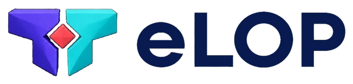
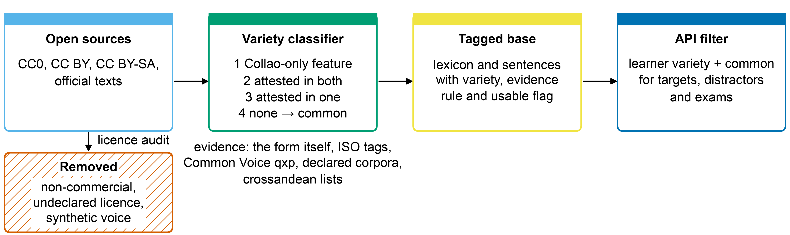
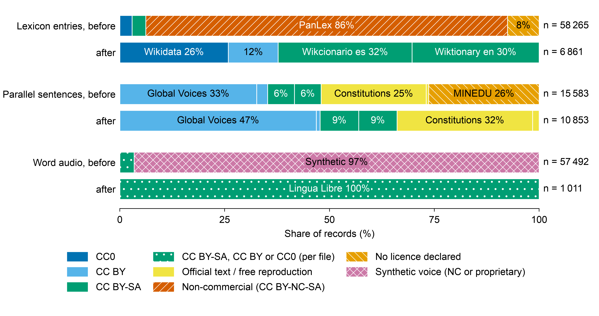
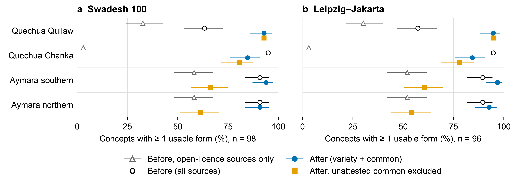
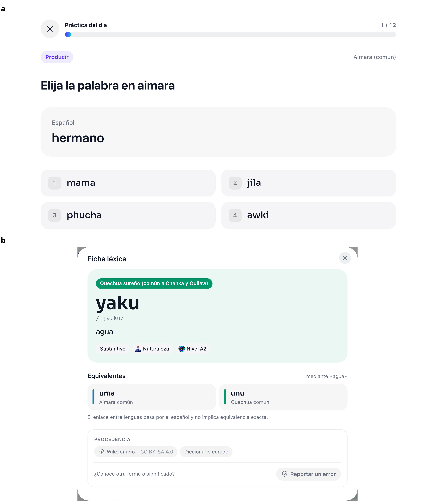

<p align="center">
  
</p>

<h1 align="center">SimiAru</h1>

<p align="center"><b>Recurso abierto español–quechua–aimara, separado por variedad, para estudiantes</b><br>
<i>simi</i> y <i>aru</i> significan «palabra» en quechua y en aimara</p>

<p align="center"><a href="README.md">Read in English</a></p>

---

## Qué es

SimiAru es el recurso léxico y de oraciones de [eLOP](https://elop.ginit.dev), la plataforma web que enseña quechua sureño y aimara a hispanohablantes de Puno. Resuelve dos problemas:

1. **Variedades mezcladas.** Cada entrada se clasifica como Collao, Chanka, aimara norteño, aimara sureño o común, con reglas fijas y evidencia registrada.
2. **Licencias restrictivas.** Solo usa fuentes CC0, CC BY, CC BY-SA, de dominio público u oficiales. Todo se puede redistribuir y usar comercialmente citando la fuente.

<p align="center"></p>

## Variedades

| Lengua | Variedad | Zona | Entradas |
|---|---|---|---:|
| Quechua | Collao (Qullaw) | Puno, Cusco, Arequipa, Moquegua, parte de Apurímac, Bolivia | 2 663 |
| Quechua | Chanka | Ayacucho, Huancavelica, parte de Apurímac | 116 |
| Quechua | común | atestiguada en ambas o sin rasgos de variedad | 2 504 |
| Aimara | norteño | Huancané, Moho, San Antonio de Putina, parte de Azángaro | 5 |
| Aimara | sureño | Chucuito, El Collao, Yunguyo, Puno; Moquegua, Tacna, altiplano boliviano | 19 |
| Aimara | común | sin atestiguación regional en fuentes abiertas | 1 554 |

Reglas completas en [`datos/VARIEDADES.md`](datos/VARIEDADES.md).

## Resultados principales

| Medida | Antes | Después |
|---|---:|---:|
| Entradas léxicas | 58 265 | 6 861 |
| De fuentes no comerciales o sin licencia | 54 667 (93,8 %) | 0 |
| Oraciones | 15 583 | 10 853 |
| Entradas con audio | 57 492 | 1 011 |
| Audio sintético | 55 535 (96,6 %) | 0 |
| Entradas Chanka con rasgos del Collao | 156 | 0 |
| Cobertura Swadesh 100, estudiantes Collao | 63 % | 93 % |
| Cobertura Swadesh 100, estudiantes Chanka | 95 % | 85 % |

En 12 025 ejercicios generados para cuatro perfiles, ninguna respuesta ni distractor salió de la variedad del estudiante.

<p align="center"></p>
<p align="center"></p>
<p align="center"></p>

## Reconstruir

```bash
python3 datos/scripts/01_descargar_fuentes.py
python3 datos/scripts/03_audio_humano.py
python3 datos/scripts/02_construir_base.py
python3 datos/scripts/10_calidad_glosas.py
python3 datos/scripts/08_ejemplos_gramatica.py
```

## Licencia

- Datos (`datos/curado/`): [CC BY-SA 4.0](LICENSE-DATA).
- Código: [MIT](LICENSE).
- Cite las fuentes originales listadas en [`datos/fuentes/README.md`](datos/fuentes/README.md).

## Limitaciones

- *Chanka* significa atestiguada en Chanka, no exclusiva de esa variedad.
- El 91 % del aimara no tiene evidencia regional en fuentes abiertas.
- Las glosas aún no están validadas por hablantes; el kit de revisión está en `experimentos/lre/revision/`.

## Contacto

Richar Andre Vilca Solorzano · [ORCID 0009-0003-2385-5263](https://orcid.org/0009-0003-2385-5263) · andrevilcasolorzano@gmail.com
